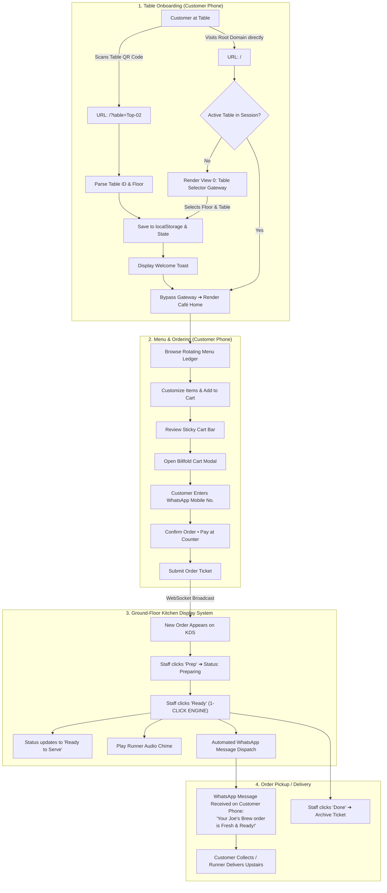

# Product Requirements Document (PRD)
## Joe's Brew In-House Ordering & Automated KDS Notification Platform

**Document Version:** 2.0 (Unified Specification)  
**Status:** Approved for Implementation  
**Target Platform:** Mobile-First Web Application (iOS Safari, Android Chrome, Ground-Floor KDS Tablet)  
**Architecture:** Real-time WebSockets / SSE + REST API + Vanilla CSS Design Tokens  

---

## 1. Executive Summary & Vision

**Joe's Brew** (Estd 2006) operates across a two-story physical layout:
- **Ground Floor:** Kitchen, espresso bar, and 4 seated tables (`Ground-01` to `Ground-04`).
- **Upstairs Floor:** Quiet lounge seating with 4 seated tables (`Top-01` to `Top-04`).

### Core Value Proposition
Eliminates ordering friction and communication delays between upstairs customers and the ground-floor kitchen through:
1. **Zero-Friction QR Table Entry:** Tabletop QR codes that instantly lock in floor and table numbers without requiring manual entry or app downloads.
2. **Table Selector Gateway:** An atmospheric root landing page for direct visitors to select their seating or scan their table plaque.
3. **Automated 1-Click KDS "Ready" WhatsApp Dispatch:** When kitchen staff click the **"Ready"** button on an active ticket, the system automatically triggers a personalized WhatsApp order-ready notification to the customer's phone number without requiring a separate notification button or extra clicks.
4. **Preservation of Heritage & Features:** 100% retention of the 1920s speakeasy café aesthetic, rotating menu ledger, Pay at Counter billing, waiter service call bell, and thumb-friendly mobile ergonomics.

---

## 2. End-to-End System Architecture



---

## 3. Physical QR Code Table Deployment & URL Protocol

### 3.1 Physical Table Directory (8 Symmetrical Tables)
The café operates exactly 8 physical tables:

| Table ID | Floor Zone | Physical Stand Label | QR Code Encoded URL |
| :--- | :--- | :--- | :--- |
| `Top-01` | Upstairs | Upstairs — Table 1 | `https://joesbrew.in/?table=Top-01` |
| `Top-02` | Upstairs | Upstairs — Table 2 | `https://joesbrew.in/?table=Top-02` |
| `Top-03` | Upstairs | Upstairs — Table 3 | `https://joesbrew.in/?table=Top-03` |
| `Top-04` | Upstairs | Upstairs — Table 4 | `https://joesbrew.in/?table=Top-04` |
| `Ground-01` | Ground Floor | Ground — Table 1 | `https://joesbrew.in/?table=Ground-01` |
| `Ground-02` | Ground Floor | Ground — Table 2 | `https://joesbrew.in/?table=Ground-02` |
| `Ground-03` | Ground Floor | Ground — Table 3 | `https://joesbrew.in/?table=Ground-03` |
| `Ground-04` | Ground Floor | Ground — Table 4 | `https://joesbrew.in/?table=Ground-04` |

### 3.2 URL Routing Specification
The client application parses query parameters on load:
- Primary: `?table=<TABLE_ID>` (e.g. `?table=Top-03`)
- Shorthand alias: `?t=<TABLE_ID>` (e.g. `?t=Ground-01`)
- Optional view override: `&view=menu` (e.g. `?table=Top-04&view=menu` jumps directly to the menu ledger).

---

## 4. Dual-Path Customer Onboarding

### 4.1 Path A: Direct Table QR Scan (Zero-Click Fast Track)
1. Customer sits at **Table Top-02** upstairs and scans the tabletop brass plaque.
2. Smartphone browser opens `https://joesbrew.in/?table=Top-02`.
3. Client records `state.selectedTable = 'Top-02'` and `state.selectedFloor = 'Upstairs'`, persisting to `localStorage.getItem('jb_table')`.
4. Displays an ambient amber toast: *"Seated at Upstairs · Table Top-02"*.
5. Bypasses the Table Selector Gateway entirely, landing on the **Café Home** with `Top-02` illuminated on the navbar badge.

### 4.2 Path B: Direct Web Visit (Table Selector Gateway Screen)
1. Customer enters `https://joesbrew.in` directly without a table parameter and has no active table stored.
2. The browser renders **View 0: Table Selector Gateway**:
   - Vintage crest logo & header: *"Welcome to Joe's Brew · Estd 2006"*.
   - Headline: *"Where are you seated today?"*.
   - Subtitle: *"Select your table below or scan the QR code stand on your tabletop to begin ordering."*.
   - Symmetrical Floor Grids:
     - **Upstairs Seating (1st Floor):** 4 brass-bordered touch cards (`Top-01`, `Top-02`, `Top-03`, `Top-04`).
     - **Ground Floor Seating:** 4 brass-bordered touch cards (`Ground-01`, `Ground-02`, `Ground-03`, `Ground-04`).
   - Action: Tapping any table selects it immediately with an active brass glow, persists the choice, and smoothly transitions into the **Café Home** view.

### 4.3 Table Switcher (In-Session Flexibility)
Customers can change tables at any time by tapping the table badge (`#tableSelectorBtn`) in the top navigation bar. Changing tables updates active ticket routing without clearing cart items.

---

## 5. Automated KDS 1-Click "Ready" Notification Engine

### 5.1 The Friction Problem Solved
Previously, kitchen staff had to click two separate buttons:
1. Click the status button to mark `Ready to Serve`.
2. Find and click an external `📲 WhatsApp Ready Alert` link to open WhatsApp.

Under this PRD, the separate WhatsApp button is **completely removed** from the KDS ticket card. A single tap on the **"Ready"** button performs both actions atomically.

### 5.2 1-Click "Ready" Execution Flow
When the KDS operator taps **"Ready"**:
- The order status updates to `Ready to Serve` via API (`PATCH /api/orders/:id/status`).
- Audio runner chime plays.
- If the customer provided a phone number, the system automatically opens WhatsApp with the formatted order-ready message for that customer.
- Ticket status updates on the screen and syncs across all connected clients via WebSocket.

### 5.3 Automated WhatsApp Message Template
```text
☕ *Joe's Brew (Estd 2006)* ☕

Hello {CustomerName}! 🌟
Great news! Your order #{OrderNo} for Table {TableId} ({Floor}) is freshly prepared, hot & delicious! 🎉✨

📋 *Order Items:* {ItemsSummary}

🔔 *Kindly come and get your order from our service point in the kitchen!* 🍽️

We hope every bite and sip brings a bright smile to your day. Enjoy your blissful brew & treats! 💛☕🍰
```

---

## 6. Non-Breaking Compatibility Matrix (Old Features Preserved)

| Core Feature | Previous Functionality | Unified PRD Specification | Status |
| :--- | :--- | :--- | :--- |
| **Café Home View** | Speakeasy hero, story, reserve specials | Intact 100%. Displays immediately after QR scan or gateway selection. | ✅ Preserved |
| **Café Menu Ledger** | Category pills, parchment cards, tasting notes modal, '+ Add' | Intact 100%. Filter and add actions unaffected. | ✅ Preserved |
| **WhatsApp Customer Modal** | Pre-checkout modal asking for customer's mobile number and name | Intact 100%. Validates 10-digit Indian phone with auto-complete. | ✅ Preserved |
| **Sticky Cart Bar** | Floating amber brass bar showing item count and total | Intact 100%. Displays above bottom nav on mobile without collisions. | ✅ Preserved |
| **Kitchen Display System** | Ground-floor live ticket board tracking upstairs & ground tables | Intact 100%. Enhanced with 1-click automatic WhatsApp alert on 'Ready'. | ✅ Preserved |
| **Waiter Call Bell** | Instant service alert sent to KDS with table ID & reason | Intact 100%. Accessible from navbar and mobile bottom nav. | ✅ Preserved |
| **Pay at Counter Billing** | Settle at Counter (Cash/Card) | Intact 100%. No online payment required; customer pays at billing desk. | ✅ Preserved |
| **Symmetrical Tables** | 4 Upstairs (`Top-01`–`Top-04`) & 4 Ground (`Ground-01`–`Ground-04`) | Intact 100%. Matched in QR codes, gateway, and KDS tickets. | ✅ Preserved |
| **Strict Café Terminology** | No tavern, barista, or brewery words | Intact 100%. Enforced across customer UI and KDS. | ✅ Preserved |
| **Mobile Ergonomics** | Bottom sheets, iOS safe areas, `:active` scaling, 16px inputs | Intact 100%. Extended to the new Table Selector Gateway. | ✅ Preserved |
