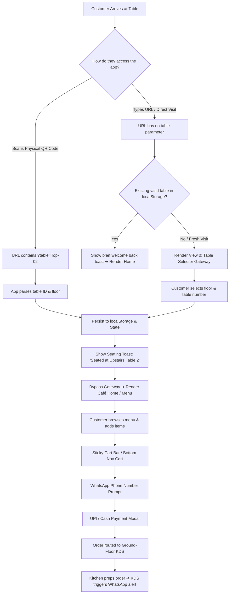

# Product Requirements Document (PRD)
## Joe's Brew — QR Code Table Routing & Table Selector Gateway System

**Document Version:** 1.0  
**Status:** Approved for Implementation  
**Target Platform:** Mobile-First Web Application (iOS Safari, Android Chrome, Desktop Web)  

---

## 1. Executive Summary & Vision

At **Joe's Brew** (Estd 2006), the physical café spans two distinct zones:
- **Ground Floor Seating** (Tables 1 to 4)
- **Upstairs Seating** (Tables 1 to 4)
- **Ground Floor Kitchen & Espresso Bar**

To eliminate ordering friction and ensure kitchen staff always know exactly where to deliver orders and send waitstaff, every physical table will feature an engraved brass or acrylic QR code plaque. 

This PRD specifies the **Dual-Path Table Onboarding & QR Routing System**:
1. **Direct QR Code Scan Path:** When a seated customer scans their table's physical QR code with their mobile camera, the website instantly detects the table ID from the URL (`?table=Top-02`), saves it to local session state, displays a welcoming seating confirmation, and bypasses the selection gate directly into the **Café Home** or **Menu**.
2. **Direct Root Landing Path (Table Selector Gateway):** When a customer opens the website directly (e.g. typing the web address or opening a bookmark without a table URL parameter or saved session), the initial landing view is a dedicated, atmospheric **Table Selector Gateway Screen** prompting them to select their table (Upstairs vs. Ground) or scan the on-table QR code.
3. **Zero Feature Compromise:** All established features—including the vintage speakeasy café aesthetic, mobile bottom navigation, sticky cart bar, WhatsApp order notifications, ground-floor Kitchen Display System (KDS) live sync, and UPI payments—remain 100% intact and functional.

---

## 2. Table Layout & QR Code URL Schema

### 2.1 Physical Table Roster
The café operates exactly 8 physical tables:

| Table ID | Floor Zone | Physical Table Label | QR Code Destination URL |
| :--- | :--- | :--- | :--- |
| `Top-01` | Upstairs | Upstairs — Table 1 | `https://joesbrew.in/?table=Top-01` |
| `Top-02` | Upstairs | Upstairs — Table 2 | `https://joesbrew.in/?table=Top-02` |
| `Top-03` | Upstairs | Upstairs — Table 3 | `https://joesbrew.in/?table=Top-03` |
| `Top-04` | Upstairs | Upstairs — Table 4 | `https://joesbrew.in/?table=Top-04` |
| `Ground-01` | Ground Floor | Ground — Table 1 | `https://joesbrew.in/?table=Ground-01` |
| `Ground-02` | Ground Floor | Ground — Table 2 | `https://joesbrew.in/?table=Ground-02` |
| `Ground-03` | Ground Floor | Ground — Table 3 | `https://joesbrew.in/?table=Ground-03` |
| `Ground-04` | Ground Floor | Ground — Table 4 | `https://joesbrew.in/?table=Ground-04` |

### 2.2 QR Code URL Parameters
The application client must support the following parameter variations:
- `?table=<TABLE_ID>` (primary, e.g., `?table=Top-03`)
- `?t=<TABLE_ID>` (shorthand alias for compact QR codes, e.g., `?t=Ground-01`)
- Optional view override: `&view=menu` (e.g., `?table=Top-01&view=menu` opens the Menu ledger directly).

---

## 3. Customer User Journeys

### 3.1 Journey A: Table QR Code Scan (Fast Track)
1. Customer sits at **Table Top-02** (Upstairs).
2. Customer points phone camera at the brass table QR stand.
3. Browser loads `https://joesbrew.in/?table=Top-02`.
4. Client detects `table=Top-02`.
5. Client saves `jb_table = 'Top-02'` in `localStorage`.
6. Client displays an ambient brass toast: *"Seated at Table Top-02 · Upstairs Seating"*.
7. Customer lands immediately on the **Café Home View** (or **Café Menu** if `&view=menu`), with `Top-02` illuminated in the top navigation bar.
8. The Table Selector Gateway is **not shown**.

### 3.2 Journey B: Direct URL Visit (Table Selector Gateway)
1. Customer visits `https://joesbrew.in` directly without a QR code scan and has no active table in storage.
2. The application presents the **Table Selector Gateway View**:
   - Header: Joe's Brew crest & vintage typography *"Welcome to Joe's Brew · Estd 2006"*.
   - Title: *"Where are you seated today?"*.
   - Subtitle: *"Select your table below or scan the QR stand at your table to begin ordering."*.
   - Visual Floor Dividers:
     - **Upstairs Seating** (4 large brass-bordered cards: `Top-01`, `Top-02`, `Top-03`, `Top-04`).
     - **Ground Floor Seating** (4 large brass-bordered cards: `Ground-01`, `Ground-02`, `Ground-03`, `Ground-04`).
   - Action: Tapping any table card animates the selection (brass shimmer) and activates a prominent *"Enter Café & View Menu"* button.
3. Upon selection, the table is saved, the gateway view smoothly transitions out, and the customer enters the **Café Home View**.

### 3.3 Journey C: In-Session Table Switching
- If a customer changes seats (e.g., moves from `Ground-02` to `Top-01`), they can tap the table badge in the top navigation bar at any time.
- The Table Selector modal appears as a bottom sheet.
- Changing tables updates their active ticket, header badge, and cart context without clearing their cart items.

---

## 4. Non-Breaking Compatibility Matrix (Old Features Preserved)

| Feature | Prior Behavior | Behavior With QR & Gateway System | Status |
| :--- | :--- | :--- | :--- |
| **Café Home Page** | Standard landing page with hero, reserve specials, story | Retained 100%. Displays immediately after QR scan or gateway selection. | ✅ Preserved |
| **Café Menu Ledger** | Categorized rotating menu with parchment cards and '+ Add' | Retained 100%. Accessible via bottom nav, top nav, or direct `&view=menu`. | ✅ Preserved |
| **Sticky Cart Bar** | Floats above bottom nav showing item count & total | Retained 100%. Continues to bind orders to the active table. | ✅ Preserved |
| **WhatsApp Details Modal** | Captures mobile number before checkout for order updates | Retained 100%. Auto-populates stored name/phone and attaches to the table ticket. | ✅ Preserved |
| **Kitchen Display System (KDS)** | Live real-time dashboard tracking tickets by floor & table | Retained 100%. Ticket headers display exact table (`UPSTAIRS - TOP-02` or `GROUND - GROUND-01`). | ✅ Preserved |
| **UPI & Counter Payment** | Instant UPI apps (GPay, PhonePe, Paytm, BHIM) & Cash | Retained 100%. Pay at table or settle at counter preserved. | ✅ Preserved |
| **Waiter Service Call Bell** | Sends instant service alert to KDS | Retained 100%. Routes waiter directly to the selected table. | ✅ Preserved |
| **Terminology Standards** | Strict café words (no barista/tavern/brewery) | Retained 100%. All gateway text uses café terminology. | ✅ Preserved |
| **Mobile Optimizations** | Bottom sheets, iOS safe areas, 4-column layout | Retained 100%. Built directly into the gateway screen design. | ✅ Preserved |
