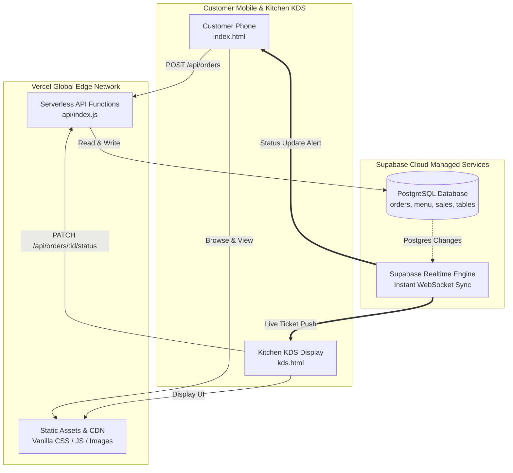

# 🚀 Joe's Brew — Supabase & Vercel Deployment Guide

This guide walks you through deploying **Joe's Brew In-House Ordering & Brand Website** to **Vercel** (Frontend & Serverless API) paired with **Supabase** (PostgreSQL Database & Zero-Maintenance Realtime WebSockets).

---

## 🏗️ Architecture Overview



---

## Step 1: Create & Configure Supabase (Database & Realtime)

1. Go to **[supabase.com](https://supabase.com)** and sign in (or create a free account).
2. Click **"New Project"**:
   - **Name:** `joes-brew`
   - **Database Password:** (Choose a strong password and save it)
   - **Region:** Choose the region closest to your customers (e.g., *South Asia / Mumbai* or your nearest region).
   - Click **Create new project** (takes ~1–2 minutes to provision).

3. **Run the Database Schema:**
   - In your Supabase project dashboard, click on the **SQL Editor** tab (icon with `>_` on the left sidebar).
   - Click **"New query"**.
   - Open [`supabase/schema.sql`](file:///d:/Web%20app/Cafe%20Project/supabase/schema.sql) in this repository, copy all the contents, paste them into the SQL editor, and click **"Run"**.
   - ✅ **What this does:**
     - Creates tables for `tables`, `menu_items`, `orders`, `waiter_calls`, and `daily_sales`.
     - Automatically seeds all **8 cafe tables** and **24 handcrafted menu creations**.
     - Configures **Row Level Security (RLS)** policies.
     - Enables **Supabase Realtime** on `orders`, `waiter_calls`, and `menu_items`.

4. **Copy Your API Credentials:**
   - On the left sidebar, click on **Project Settings** (gear icon) -> **API**.
   - Copy the following values:
     - **Project URL:** e.g., `https://abcdefghijklm.supabase.co`
     - **Project API Keys -> `anon` (public):** e.g., `eyJhbGciOiJIUzI1NiIsInR5cCI6...`
     - **Project API Keys -> `service_role` (secret):** (Used securely by the serverless backend)

---

## Step 2: Push Your Project to GitHub

If you haven't pushed your repository to GitHub yet:

1. Create a new repository on **[github.com](https://github.com)** (e.g. `joes-brew`).
2. In your terminal, run:
   ```bash
   git add .
   git commit -m "feat: complete mobile UX overhaul and Supabase + Vercel deployment configuration"
   git branch -M main
   git remote add origin https://github.com/<your-username>/joes-brew.git
   git push -u origin main
   ```

---

## Step 3: Deploy to Vercel

1. Go to **[vercel.com](https://vercel.com)** and sign in with your GitHub account.
2. On your Vercel dashboard, click **"Add New..."** -> **"Project"**.
3. Locate your `joes-brew` repository and click **"Import"**.
4. In the configuration window:
   - **Framework Preset:** Leave as `Other`.
   - **Root Directory:** Leave as `./` (default).
5. Expand the **Environment Variables** section and add the following keys:

| Key | Value (from Supabase & Config) | Description |
|---|---|---|
| `SUPABASE_URL` | `https://your-project-ref.supabase.co` | Your Supabase Project URL |
| `SUPABASE_ANON_KEY` | `eyJhbGci...` | Supabase `anon` public key |
| `SUPABASE_SERVICE_ROLE_KEY` | `eyJhbGci...` | Supabase `service_role` secret key |
| `KDS_PIN` | `2006` | Staff PIN for kitchen station login |
| `KDS_USER` | `admin` | Staff username |
| `KDS_PASSWORD` | `brew2006` | Staff password |

6. Click **"Deploy"**!
   - Vercel will build and deploy your application in under 30 seconds.
   - You will receive a live production URL: `https://joes-brew.vercel.app` (or custom name).

---

## Step 4: Verify Live In-House Ordering & KDS

1. **Customer Mobile Experience:**
   - Open `https://your-domain.vercel.app` on your smartphone.
   - Or simulate tabletop QR code scanning directly:
     `https://your-domain.vercel.app/?table=Top-04`
   - Notice the table locks in, the mobile view is compact, and there are zero awkward dead spaces!

2. **Kitchen Display System (KDS):**
   - Open `https://your-domain.vercel.app/kds` on a tablet, kitchen screen, or second browser window.
   - Enter Station PIN: `2006`.
   - Place an order on the mobile phone — it pops up immediately on the KDS via Supabase Realtime!
   - Click **"Ready to Serve"** in the KDS — the customer's phone immediately chimes with the cheerful service point collection prompt!
   - At the end of the shift, tap **"Finalize Shift & Log Out"** to view and store the daily sales settlement ledger (retained permanently in Supabase for 7+ days).

---

## 🛠️ Local vs Production Modes

Your application is built with **Dual-Mode Architecture**:

| Feature | Local Development (`npm run dev`) | Production (`Vercel + Supabase`) |
|---|---|---|
| **Database** | Local JSON (`data/menu.json`, `data/orders.json`) | Cloud PostgreSQL via Supabase |
| **Realtime** | Built-in Node.js WebSocket (`ws://localhost:3000`) | Cloud Supabase Realtime Channels |
| **Offline Dev** | Works completely offline with zero configuration | Live globally on Vercel CDN |
| **Data Retention** | Local files | Permanent multi-year database |
